# Aircraft: Realistic and Remastered for OpenTTD

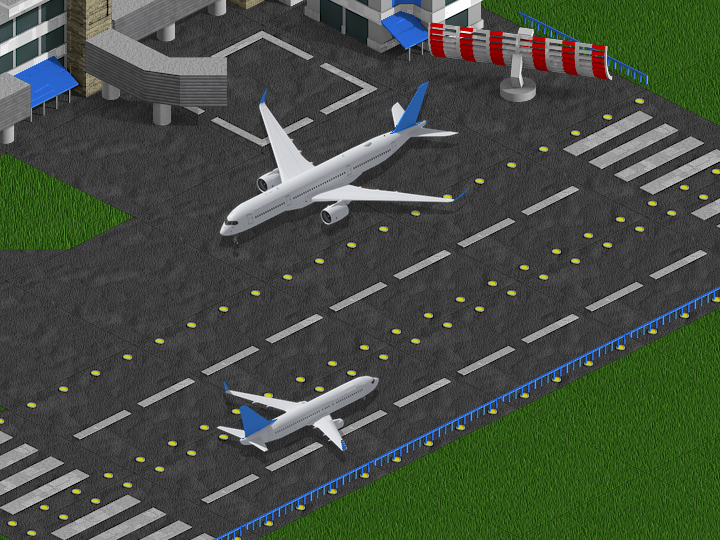

> [!WARNING]
> **Pre-release version.** This set is still in development: graphics are being added aircraft by aircraft, and graphics and values may still change between versions. Work on aircraft details and on the liveries and paint is in progress.

Aircraft: Realistic and Remastered is an aircraft set (NewGRF) for [OpenTTD](https://www.openttd.org), the open source transport simulation game. It replaces every default aircraft with 37 real airliners and 4 helicopters, from the Junkers Ju 52 of 1930 to the Boeing 737 MAX of 2017.

## Features

* Real aircraft names, such as Douglas DC-8, British Aerospace BAe 146 and Airbus A330.
* Real specifications from the [AirwaySim - Airline Game](https://www.airwaysim.com) aircraft database: introduction dates, cruise speeds, capacities, fuel burn, maintenance and list prices, scaled to the OpenTTD economy so costs and earnings stay close to the default game.
* Every aircraft flies in your company's colours, as in the original Transport Tycoon Deluxe, instead of random liveries or plain white.
* Graphics rendered from 3D models of the real aircraft, so every type has its own recognisable silhouette (in progress, see the table below).
* Landing gear down on the ground and while landing, retracted in flight. Tail-draggers such as the Ju 52 and DC-3 sit on their tail wheel on the ground.
* Helicopters with a spinning main rotor and an animated tail rotor that spins in the air and stands still on the ground.
* Spinning propellers on the propeller airliners, in the air and while taxiing; parked at the gate they stand still (not yet on the Ju 52 and Viscount).
* Graphics for both normal zoom and 4x zoom (32bpp).
* Passengers, mail, goods and valuables, with capacities based on each aircraft's real cargo hold.
* Correct airport class: small aircraft use small airports, airliners need large ones.
* Long buying periods: every aircraft is on sale for at least 30 years, and types still in production never expire.
* The same aircraft in every climate, including Toyland, and no default aircraft left in the purchase list.
* Compatible with "Original vehicle names".

## Aircraft

Graphics status: 🟢 **Ready** means finished. 🟡 **In progress** means the 3D model is done, but its details and livery are not finished yet. 🔴 **Not done** means the aircraft still uses placeholder graphics from the original game.

<!-- aircraft-table:start -->

| Preview | Aircraft | Baseline model | Introduced | Graphics |
|---|---|---|---|---|
| 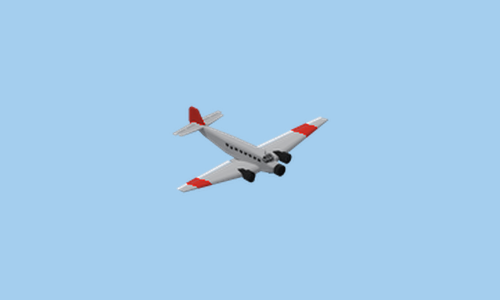 | Junkers Ju 52 | Junkers Ju 52/3m | 1930 | 🟡 In progress |
| 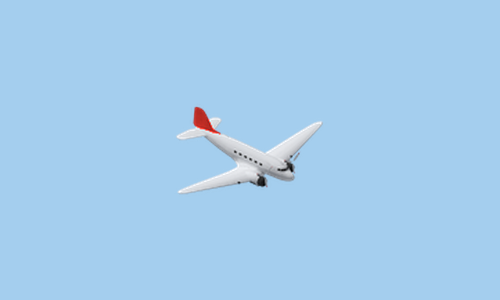 | Douglas DC-3 | Douglas DC-3 | 1936 | 🟡 In progress |
| 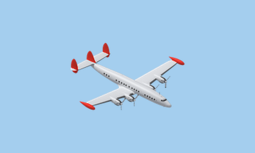 | Lockheed Constellation | Lockheed L-1049G Super Constellation | 1946 | 🟡 In progress |
| 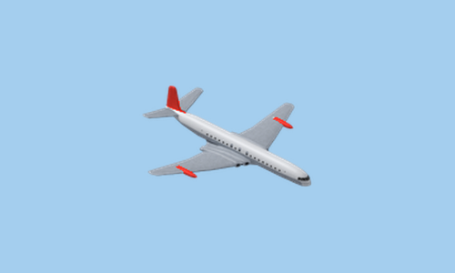 | de Havilland D.H.106 Comet | de Havilland DH.106 Comet 4 | 1952 | 🟡 In progress |
| 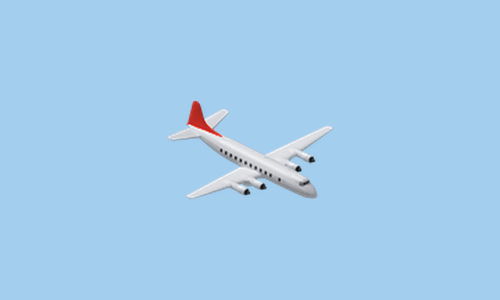 | Vickers Viscount | Vickers Viscount 800 | 1953 | 🟡 In progress |
| 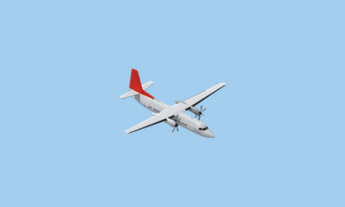 | Fokker F27 Friendship | Fokker F.27 Mk 200 Friendship | 1958 | 🟡 In progress |
| 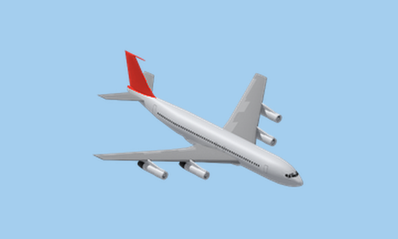 | Boeing 707 | Boeing 707-320B | 1958 | 🟡 In progress |
| 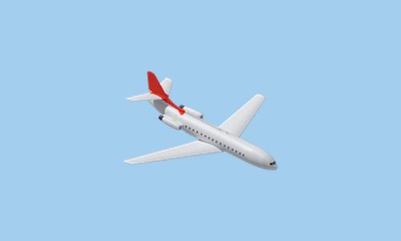 | Sud Aviation SE-210 Caravelle | Sud Aviation SE-210 Caravelle III | 1959 | 🟡 In progress |
| 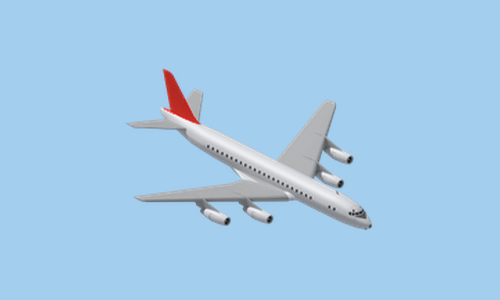 | Douglas DC-8 | Douglas DC-8-51 | 1959 | 🟡 In progress |
| 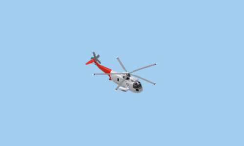 | Sikorsky S-61 | Sikorsky S-61N | 1962 | 🟡 In progress |
| 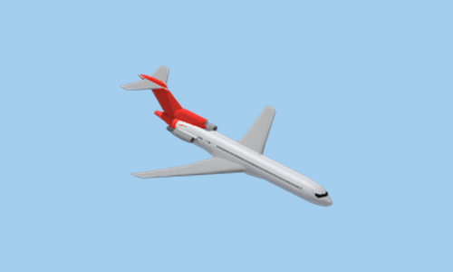 | Boeing 727 | Boeing 727-200Adv | 1964 | 🟡 In progress |
| 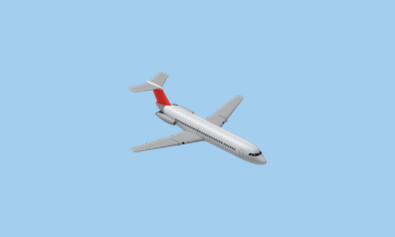 | BAC One-Eleven | BAC One-Eleven 500 | 1965 | 🟡 In progress |
| 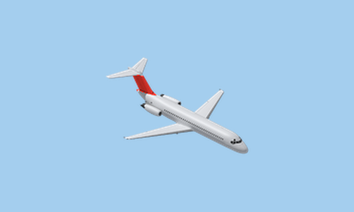 | Douglas DC-9 | McDonnell Douglas DC-9-31 | 1965 | 🟡 In progress |
| 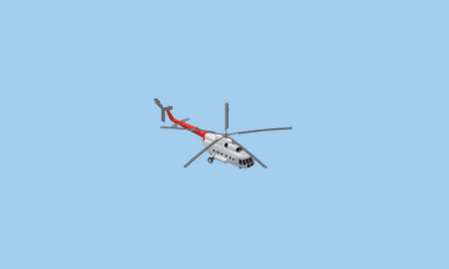 | Mil Mi-8 | Mil Mi-8P | 1967 | 🟡 In progress |
| 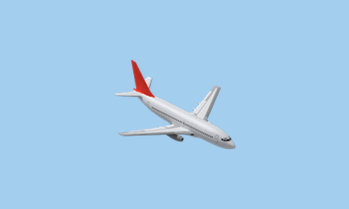 | Boeing 737 | Boeing 737-200 Adv | 1967 | 🟡 In progress |
| 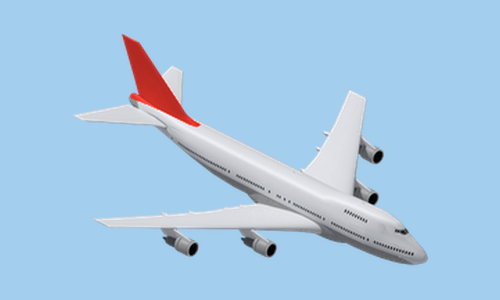 | Boeing 747 | Boeing 747-200B | 1969 | 🟡 In progress |
| 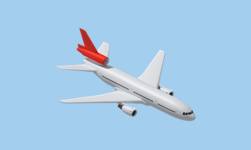 | McDonnell Douglas DC-10 | McDonnell Douglas DC-10-10 | 1971 | 🟡 In progress |
| 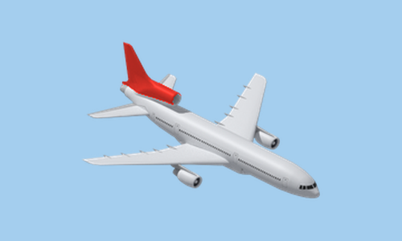 | Lockheed L-1011 TriStar | Lockheed L-1011 TriStar 500 | 1972 | 🟡 In progress |
| 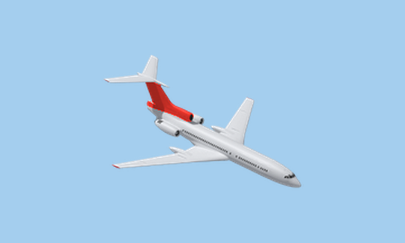 | Tupolev Tu-154 | Tupolev Tu-154M | 1972 | 🟡 In progress |
| 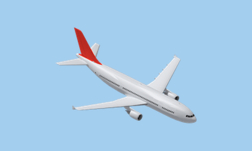 | Airbus A300 | Airbus A300B4-200 | 1974 | 🟡 In progress |
| 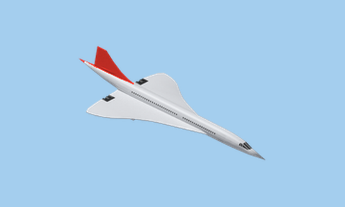 | Aérospatiale/BAC Concorde | Aérospatiale / BAC Concorde | 1976 | 🟡 In progress |
| 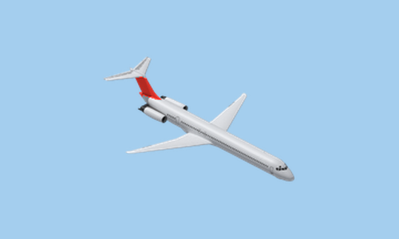 | McDonnell Douglas MD-80 | McDonnell Douglas MD-82 | 1980 | 🟡 In progress |
| 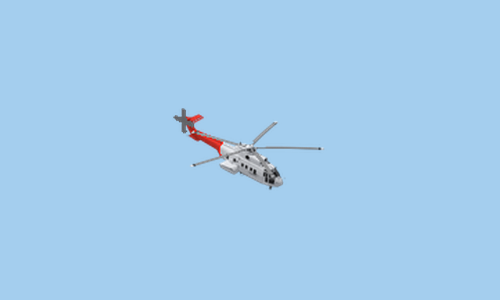 | Aérospatiale AS332 Super Puma | Aérospatiale AS332L Super Puma | 1981 | 🟡 In progress |
| 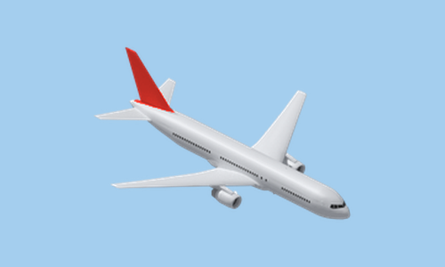 | Boeing 767 | Boeing 767-300ER | 1982 | 🟡 In progress |
| 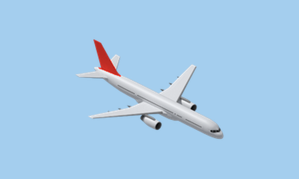 | Boeing 757 | Boeing 757-200 | 1982 | 🟡 In progress |
| 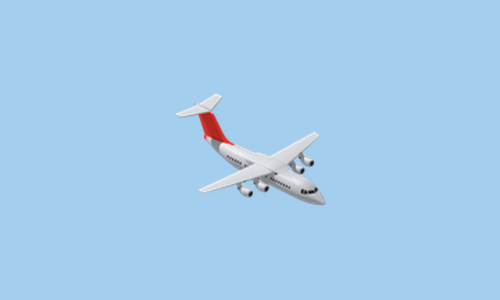 | British Aerospace BAe 146 | BAe 146-200 | 1983 | 🟡 In progress |
| 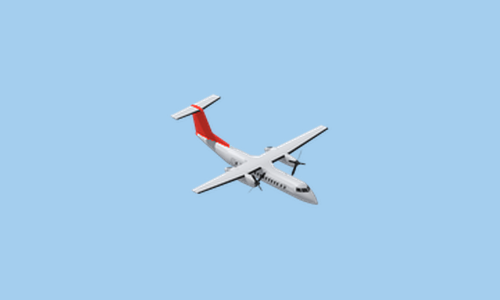 | de Havilland Canada Dash 8 | de Havilland Canada DHC-8-200B | 1984 | 🟡 In progress |
| 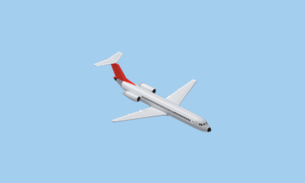 | Fokker 100 | Fokker 100 | 1988 | 🟡 In progress |
|  | Airbus A320 | Airbus A320-200 | 1988 | 🟡 In progress |
| 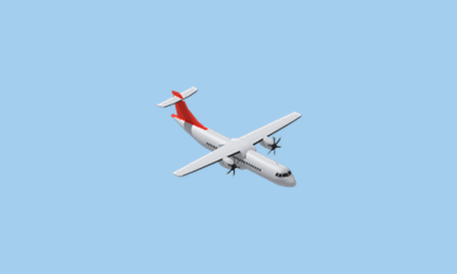 | ATR 72 | ATR 72-600 | 1989 | 🟡 In progress |
| 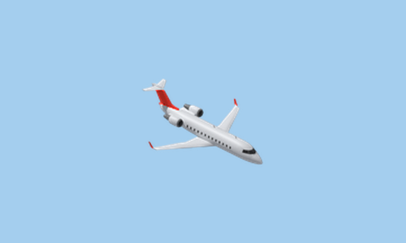 | Bombardier CRJ | Bombardier CRJ200 | 1992 | 🟡 In progress |
| 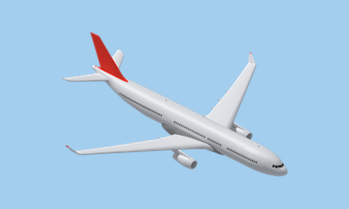 | Airbus A330 | Airbus A330-300 | 1993 | 🟡 In progress |
| 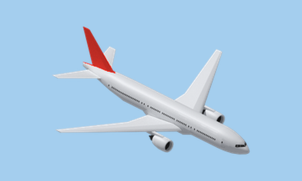 | Boeing 777 | Boeing 777-200ER | 1995 | 🟡 In progress |
| 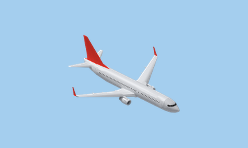 | Boeing 737NG | Boeing 737-800 | 1997 | 🟡 In progress |
| 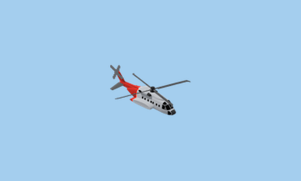 | Sikorsky S-92 | Sikorsky S-92A | 2004 | 🟡 In progress |
| 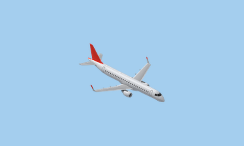 | Embraer E190 | Embraer 190STD | 2005 | 🟡 In progress |
| 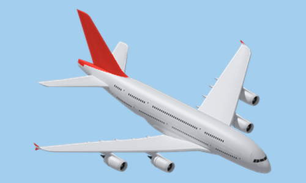 | Airbus A380 | Airbus A380-800 | 2007 | 🟡 In progress |
| 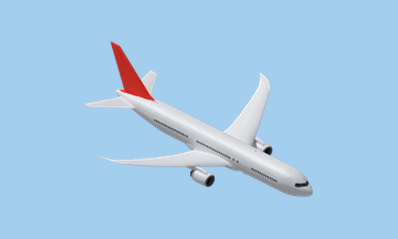 | Boeing 787 | Boeing 787-9 | 2011 | 🟡 In progress |
| 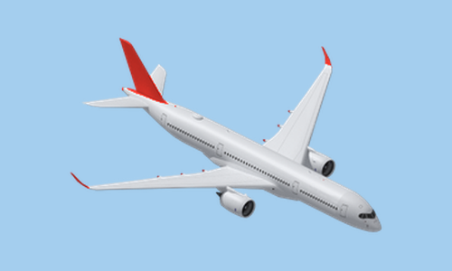 | Airbus A350 | Airbus A350-900 | 2014 | 🟡 In progress |
| 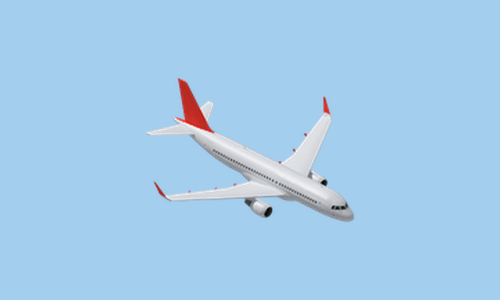 | Airbus A320neo | Airbus A320neo | 2016 | 🟡 In progress |
| 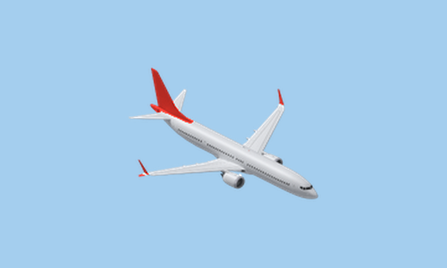 | Boeing 737 MAX | Boeing 737 MAX 8 | 2017 | 🟡 In progress |

<!-- aircraft-table:end -->

## Why only 41 aircraft?

The original game has 35 aircraft in the temperate, sub-arctic and sub-tropical climates, and 41 when the Toyland-only aircraft are counted. This set has 41, available in every climate. 

This set is a refresh of the original selection, not an encyclopedia of aviation: a short purchase list where every aircraft has a clear place by era and size, now with real aircraft and real data behind it. Each aircraft type is represented by one model, and close variants and near-identical competitors are left out to keep the choice simple.

## How realistic is it?

The airliner technical baseline data comes from the aircraft database of [AirwaySim](https://www.airwaysim.com), the realistic online airline management simulation game. Their database covers over 650 real aircraft models with accurate production dates, seating, payload, cargo volume, cruise performance, fuel burn, maintenance factors and list prices. All that has been used as the baseline for this OpenTTD modification. The entire AirwaySim database itself is not included in this package, but only the final OpenTTD values are published, in [data/aircraft.csv](data/aircraft.csv). Each aircraft type is based on one representative real model, for example the Boeing 747-200B for the Boeing 747.

**Real-world values:** names, introduction dates, passenger capacity and airport size class.

**Adapted to OpenTTD:**

* **Mail, goods and valuables** follow the real cargo hold volume and payload, scaled to the default game's cargo ratios.
* **Speeds** follow the real cruise speeds. Aircraft of the same generation fly at the same speed.
* **Running costs** combine real fuel burn and maintenance into one yearly cost. Fuel-hungry aircraft such as the Comet, Boeing 707 and Concorde cost more to run, and modern efficient aircraft such as the Airbus A320neo, Boeing 787 and Airbus A350 cost less.
* **Purchase prices** follow real list prices, scaled to the default game's price range. Concorde is the most expensive aircraft.
* **Buying period:** every aircraft can be bought for at least 30 years, and types still in production never expire.

We do not include real-world airline liveries, since we like to honour the original game and show your company's colours in the livery.

## Installation

Download `Aircraft: Realistic and Remastered` from the in-game content download (BaNaNaS), or copy `aircraft-realistic-and-remastered.grf` from the [GitHub release](https://github.com/samipuro/openttd-aircraft-realistic/releases/latest) into the `newgrf` folder of your OpenTTD user folder.

Then add it to the NewGRF list of a new game.

Tested with OpenTTD 16.

Questions, feedback and bug reports are welcome in the [tt-forums thread](https://www.tt-forums.net/viewtopic.php?t=92968) or as [GitHub issues](https://github.com/samipuro/openttd-aircraft-realistic/issues).

## Compatibility

Start a new game to use this set. In an existing games, aircraft you already own keep flying but can no longer be bought; they can be replaced with this set's aircraft through autoreplace.

Set is compatible with "Original vehicle names" in any order in the NewGRF list. Other aircraft sets that add new aircraft can be used at the same time; their aircraft appear in the purchase list next to these.

## Credits

Aircraft technical data: [AirwaySim - Online Airline Simulation](https://www.airwaysim.com)

Helicopter data: Based on manufacturer and operator information.

## Author

[Sami Puro](https://github.com/samipuro)

## License

[CC BY-NC-SA 3.0](https://creativecommons.org/licenses/by-nc-sa/3.0/) for the code, data and texts. The aircraft graphics are rendered from third-party 3D models and are not covered by this license. See [LICENSE](LICENSE).